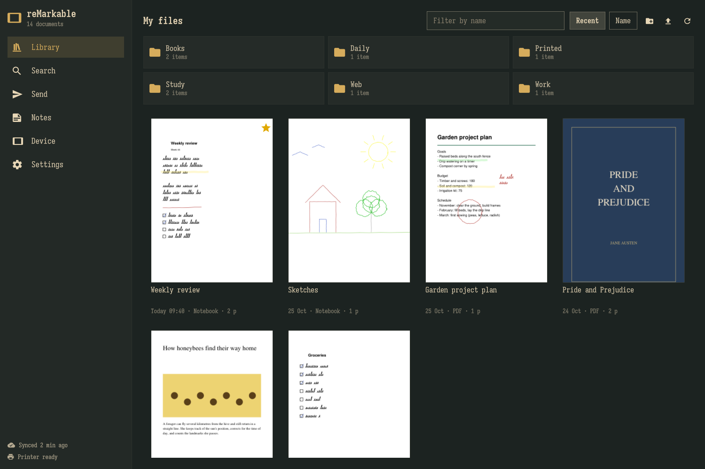

# reMarkable for Omarchy

Your reMarkable tablet on the Omarchy desktop. Built for the **reMarkable Paper Pro**
(colour pages, 1620×2160). It should work with the reMarkable 2 as well, but that
hasn't been tested yet. So far the USB and developer-mode features have only been
tested against simulated tablets.

reMarkable only makes its desktop app for Windows and macOS. This plugin covers what
that app does, and adds a few things it doesn't do.



## What it does

**Library window** (click the tablet icon in the bar, or `omarchy-shell remarkable open`)
- Browse your folders with covers. Filter by name, sort by recent or name.
- Read any notebook, PDF or EPUB page by page, drawn in colour the way the tablet
  draws it: every pen, highlighter colour, typed text, and strokes attached to text.
- Open a document in your PDF viewer, export it as PDF, images or SVG, or save the
  original file.
- Rename, move, make folders, and move things to the tablet's trash (you can restore
  them on the tablet).
- Drop files anywhere in the window to send them to the folder you're looking at.

**Send things to the tablet**
- Files: PDF and EPUB as they are. Images, text, Markdown and HTML become
  tablet-sized PDFs.
- Web pages: a clean, readable EPUB or PDF of an article. From the window, the
  popout, or the link on your clipboard.
- Screenshots: sends your newest Omarchy or Framelet screenshot.
- **Print to reMarkable**: a printer called "reMarkable" appears in every app's print
  dialog. It runs as your user, nothing system-wide.
- **Morning agenda**: a page with today's Google Calendar events and tasks, plus
  ruled space to write. Send it on demand or every morning.
- **Send folder**: save anything into `~/reMarkable/Send` and it goes to the tablet.
  Subfolders become tablet folders.
- "Send to reMarkable" in your file manager's Open With menu (turn it on under
  Settings → Desktop).

**Notes, handwriting and search**
- Markdown notes: one note per document with typed text, highlights (with their
  colours), handwriting transcriptions and page images. They work well in Obsidian.
  Anything you write below `<!-- your notes below -->` in a note survives updates.
- Handwriting to text: Claude reads your pages. It keeps whatever language and
  script you wrote in, and never translates. Each page is sent only once. Turn on
  automatic reading per folder.
- Search: titles, typed text, highlights, PDF/EPUB text and transcribed handwriting,
  all in one place.
- Local copy: every document as an annotated PDF in `~/reMarkable/Library`, kept up
  to date.

**USB cable** (no developer mode needed)
- Backups over the cable through the tablet's USB web interface. You can make them
  automatic whenever you plug the tablet in.

**Developer mode** (if you've enabled it on the tablet)
- Battery, storage and software version in the bar and the window.
- Live screen in a window (uses goMarkableStream).
- Use the tablet and Marker as a pen tablet for this computer. It appears to Hyprland as
  `omarchy-remarkable-pen`; map it to one monitor with `input:tablet:output`.
- Copy the tablet's page templates so notebooks show their lines and grids here too.
- Full backups, a custom sleep screen, and custom templates. The tablet's originals
  are backed up first, and software updates undo these changes.

**Bar**
- One icon that lights up while the plugin is working, with a tooltip summary. The
  popout has quick actions and your recent documents.
- Notifications when something changes on the tablet. Changes this computer made
  don't trigger them.

## Requirements

- Omarchy 4 (the Quickshell bar).
- `uv`, which sets up the plugin's Python environment: `omarchy pkg add uv`.
- A reMarkable account with cloud sync (my.remarkable.com).
- Optional:
  - `zenity` for the file chooser.
  - Claude Code (`claude`) or an Anthropic API key, for handwriting to text.
  - The `omarchy-calendar` command from the
    [Google Calendar plugin](https://github.com/shivam-g10/omarchy-google-calendar),
    for events on the morning agenda.

## Install

```sh
omarchy plugin add https://github.com/Dielerorn/omarchy-remarkable --enable
```

Then:

1. Click the tablet icon in the bar → **Library** → **Device** → **Get a code**,
   and paste the 8-letter code from my.remarkable.com. The plugin shows up there as a
   browser.
2. Optional, for developer mode: plug in the tablet over USB, enter its root password
   once under Device → Developer mode. The password is shown on the tablet in
   Settings → General → Help → About → Copyrights and licenses. The plugin installs its
   own SSH key and doesn't keep the password.
3. Optional: under Settings → Desktop, add "Send to reMarkable" to Open With menus and
   put the `omarchy-remarkable` command on your PATH.

The first run takes a minute: `uv` downloads the Python libraries into
`~/.local/share/omarchy-remarkable/venv`, and the plugin downloads a pinned,
checksum-verified copy of [rmapi](https://github.com/ddvk/rmapi) unless you already
have one.

### Window rule

Hyprland tiles the library window unless you tell it otherwise. To make it float
like a dialog and stay opaque, add this to `~/.config/hypr/windows.lua`:

```lua
o.window({ class = "^org.quickshell$", title = "^reMarkable$" }, { float = true, size = { 1180, 780 }, center = true, tag = "-default-opacity", opacity = "1 1" })
```

## Keybindings and scripts

```lua
-- ~/.config/hypr/bindings.lua
o.bind("SUPER + ALT + R", "reMarkable library", "omarchy-shell remarkable toggle")
o.bind("SUPER + ALT + PRINT", "Screenshot to reMarkable", "omarchy-shell remarkable sendScreenshot")
o.bind("SUPER + ALT + L", "Copied link to reMarkable", "omarchy-shell remarkable sendClipboardUrl")
```

IPC target `remarkable`: `open`, `toggle`, `search <query>`, `view <id>`, `refresh`,
`send <path>`, `sendScreenshot`, `sendClipboardUrl`, `sendAgenda`, `status`.

Everything is also a command: `omarchy-remarkable --help`, or
`~/.config/omarchy/plugins/dielerorn.remarkable/bin/omarchy-remarkable` if you haven't
put it on your PATH. Each command prints one JSON object:

```
omarchy-remarkable library
omarchy-remarkable send report.pdf notes.md photo.jpg --folder Books
omarchy-remarkable web https://example.com/article --format epub
omarchy-remarkable doc export <id> --format pdf --open
omarchy-remarkable notes sync --all
omarchy-remarkable transcribe <id> --pages 1-3
omarchy-remarkable search "aspect"
omarchy-remarkable agenda send
omarchy-remarkable usb backup
omarchy-remarkable ssh info
```

## Where things live

| What | Where |
|---|---|
| Settings | `~/.config/omarchy-remarkable/settings.json` (edit in the window) |
| Cloud login, SSH key | `~/.config/omarchy-remarkable/` (owner-only files) |
| Downloads, page images | `~/.cache/omarchy-remarkable/` (safe to delete) |
| Python env, rmapi, search index, transcripts | `~/.local/share/omarchy-remarkable/` |
| Your exports, notes, local copy, send folder, backups | `~/reMarkable/` (change in Settings) |

The helper never writes inside the plugin folder. Writing there would make the
Omarchy shell reload every plugin.

## Remove

```sh
# Take out the Open With entry and the command link, if you added them
~/.config/omarchy/plugins/dielerorn.remarkable/bin/omarchy-remarkable desktop remove
# Sign this computer out of your reMarkable cloud
~/.config/omarchy/plugins/dielerorn.remarkable/bin/omarchy-remarkable cloud unpair
omarchy plugin remove dielerorn.remarkable
# Settings, login, cache, Python environment, search index and transcripts
rm -rf ~/.config/omarchy-remarkable ~/.cache/omarchy-remarkable ~/.local/share/omarchy-remarkable
```

The printer stops along with the plugin. Your exports, notes, local copy and backups
in `~/reMarkable` stay until you delete them. To revoke the connection on
reMarkable's side as well, remove this computer from your devices at
my.remarkable.com. Then delete the window rule and keybindings if you added them.

If you used developer mode, first put back the stock sleep screen (Device → Sleep
screen → Restore) and remove any templates you added
(`omarchy-remarkable ssh templates remove <name>`). The plugin's SSH key stays on the
tablet until you delete it or reset the tablet. It's the line ending in
`omarchy-remarkable@<your computer>` in `/home/root/.ssh/authorized_keys`.

## Privacy

- Your documents travel between reMarkable's cloud and this computer, just as with
  reMarkable's own apps. Here they're downloaded and drawn locally.
- Handwriting to text sends page images to Anthropic, through your Claude Code login
  or an API key. It only happens when you ask, or for the folders you choose. Turn
  it off on the Notes page.
- Nothing else leaves your computer.
- Other accounts on the same computer can read every program's command line. So
  document names, searches, web links and print job titles never go on one: the
  plugin passes them on standard input or over D-Bus. The exceptions are files you
  open yourself (an export you open in your PDF viewer, or files you send from
  your file manager's Open With menu), whose paths reach those programs the usual
  way. The names of custom templates you add in developer mode are also part of
  the command sent to the tablet over ssh.

## How it works

- **Shell side** (`Service.qml`, `BarWidget.qml`, `Window.qml`, `ui/`) only shows
  state and asks for actions. A long-running helper (`omarchy-remarkable daemon`)
  sends status, library changes and job progress as JSON lines.
- **Helper** (`helper/rmbridge`, Python):
  - Cloud access goes through rmapi, limited to a fixed set of commands. rmapi's
    account-wiping `nuke` command can't be called, and "delete" always means "move
    to the tablet's trash".
  - Pages are drawn with rmscene and PyMuPDF.
  - The printer is CUPS's own `ippeveprinter`, running as your user.
- Developer-mode features use plain `ssh` with the plugin's own key and known-hosts
  file. They never touch `~/.ssh`.

## Development

```sh
cd helper && uv run --with pytest pytest tests
tools/install.sh   # install or update this checkout in the running shell
```

`tools/install.sh` stops the shell, updates the installed copy with git, and starts
the shell again. Writing into the plugin folder while the shell runs makes it reload
every plugin.

## Credits

Pen rendering adapted from [rmc](https://github.com/ricklupton/rmc) (MIT). It uses
[rmapi](https://github.com/ddvk/rmapi), [rmscene](https://github.com/ricklupton/rmscene),
[PyMuPDF](https://pymupdf.readthedocs.io), [trafilatura](https://trafilatura.readthedocs.io)
and [goMarkableStream](https://github.com/owulveryck/goMarkableStream). See
THIRD_PARTY_NOTICES.md.

## Licence

MIT, for the plugin's own code. PyMuPDF and rmapi, which the plugin downloads on
first run, are AGPL-3.0. See THIRD_PARTY_NOTICES.md.

reMarkable is a trademark of reMarkable AS. This is an independent project, not made
or endorsed by reMarkable.
